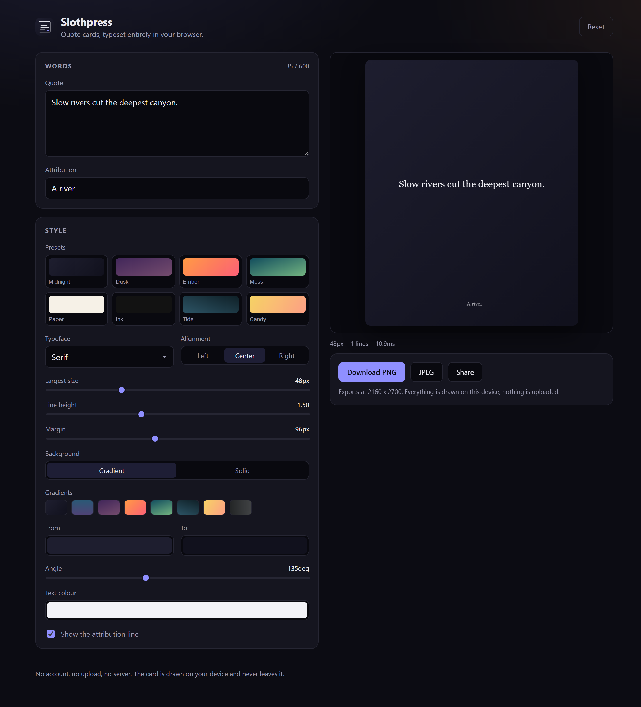

# Slothpress

Turn a few words into a typeset quote card you can post anywhere. Everything
happens on your device: no account, no upload, no server, no API keys. Open the
page, type something, download the image.



## Why

Most quote-card tools are a form, a server, and a login. The text you paste
leaves your machine, the layout is decided by someone else's template, and the
result is a link that stops working when the service does.

Slothpress is a single static page. The card is a deterministic function of the
text and the style:

```
card = render(content, author, style)
```

No randomness, no model, no network. The same input always produces the same
image, which means the layout can be checked by a machine instead of by taste.

## What it does

- Type or paste a quote. Blank lines are kept, because a poem means them.
- Pick a typeface, an alignment, a gradient, a margin, a line height.
- The text auto-fits: it shrinks to the largest size that fits the card, and
  says so when it has run out of room.
- Export at 2160 x 2700 as PNG or JPEG, or hand it straight to the share
  sheet.
- Your draft is saved in the browser. There is nothing to log into.

It installs as an app and keeps working with the network off.

## Running it

```bash
npm install
npm run dev
```

| Command | What it does |
| --- | --- |
| `npm run dev` | Development server on <http://localhost:5173> |
| `npm run build` | Typecheck, then build to `dist/` |
| `npm run preview` | Serve the production build |
| `npm run typecheck` | `tsc --noEmit` |
| `npm test` | Vitest suite |
| `npm run bench` | Layout benchmark with a time budget |

## How it fits together

```
src/lib/     the whole engine, no React
  style.ts     what a card's style is, and what happens to nonsense values
  gradient.ts  a CSS gradient parser, because ctx.fillStyle will not read one
  layout.ts    wrapping, hard-breaking and auto-fit. Pure.
  render.ts    card geometry and painting
  export.ts    getting the card out of the browser
  storage.ts   the draft, kept in localStorage
src/components/  the editor, the style picker, the preview, the export bar
db/           Postgres schema, an RLS audit, and leak scenarios
docs/         architecture notes
bench/        the layout benchmark
```

The engine has no dependency on React or on the DOM, apart from the one
function that actually needs a canvas. `layout.ts` takes a `measure` callback
instead of reaching for `ctx.measureText`, which is why the wrapping and
auto-fit are tested without a browser at all.

## The interesting part

Six things in the original design did not work. They are worth writing down,
because each one is the kind of bug that looks fine on the screen you built it
on.

1. **The gradient was never read.** The stored `bg_value` was a CSS string, but
   the renderer hard-coded its own stops, so every card had the same
   background no matter what you picked.
2. **`text_align` did nothing.** Every line was drawn at `x = 1080 / 2`,
   whatever the alignment said.
3. **Long words ran off the card.** A URL in a quote had nowhere to go.
4. **The canvas was sized in device pixels.** `canvas.width = 1080 * dpr` on a
   3x phone is a 2160 x 2700 backing store for a preview that is a third of
   that on screen. Now the backing store is separate from the layout, and the
   export is the only place the scale changes.
5. **Long text ran into the attribution.** The attribution sat at a fixed `y`,
   so a long quote landed on top of it.
6. **Nothing auto-fitted.** `font_size * 2` was a magic number, not a rule.

Each one has a test that fails without the fix. See `tests/render.test.ts`.

## The server half

The app does not need a server, but sharing a card between devices does. The
schema in `db/schema.sql` is the part that would back that, with row level
security on every table:

- `profiles` mirror `auth.users` through a signup trigger.
- `cards` hold the text and a `style_metadata` JSONB blob.
- `card_interactions` and `card_comments` carry the social side.
- `like_count` and `comment_count` are maintained by triggers, so the client
  never writes a number it could get wrong.

`db/rls-audit.sql` checks the shape of the policies (no write policy without
`WITH CHECK`, no policy that references its own table, every security definer
function with a pinned `search_path`), and `db/rls-scenarios.sql` checks what
they actually do by trying to read somebody else's card with the wrong
identity.

```bash
psql "$DATABASE_URL" -v ON_ERROR_STOP=1 -f db/schema.sql
psql "$DATABASE_URL" -v ON_ERROR_STOP=1 -f db/rls-audit.sql
psql "$DATABASE_URL" -v ON_ERROR_STOP=1 -f db/rls-scenarios.sql
```

## Deliberately not here

- **No AI in the card path.** A quote card does not need a model, and a model
  in the loop means a latency budget and an API key for a job that a line
  wrapping does better.
- **No accounts.** Not now. The first version has no way to be logged out of.
- **No photo backgrounds.** Gradients and solid colours are enough, and they
  render in a fraction of the time.
- **No server for rendering.** If the card is drawn by a server, it is a
  server, and then it is somebody else's computer making your picture.

## Licence

MIT.
